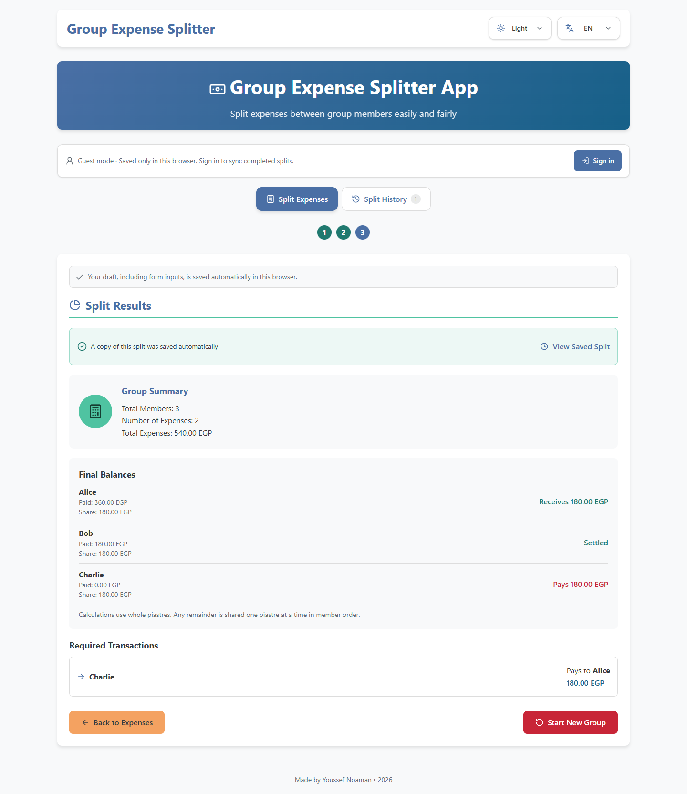
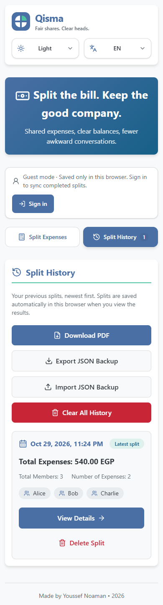
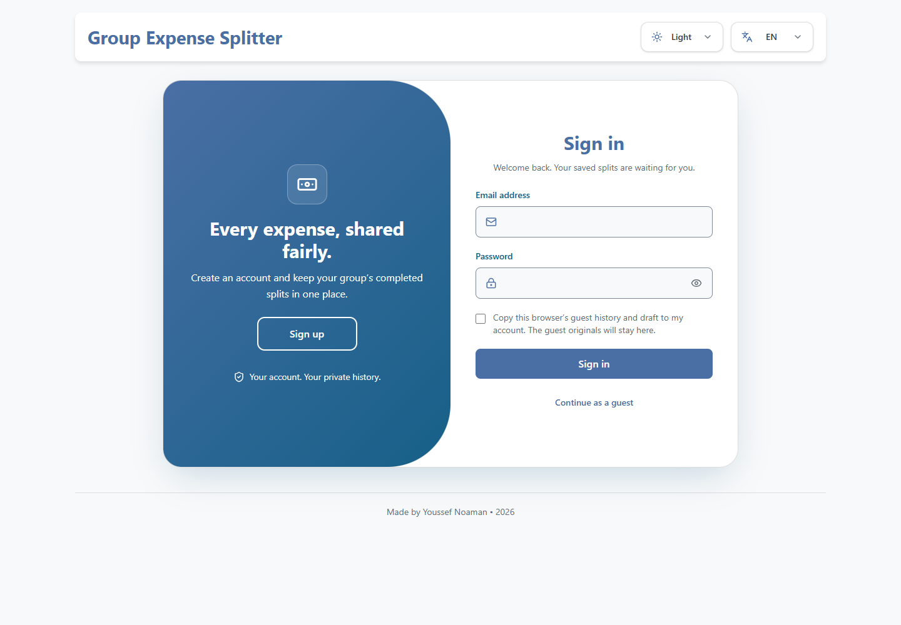
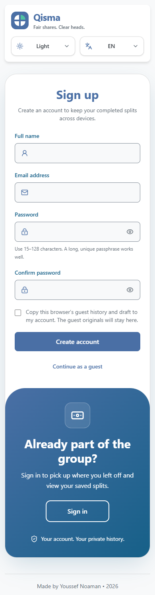
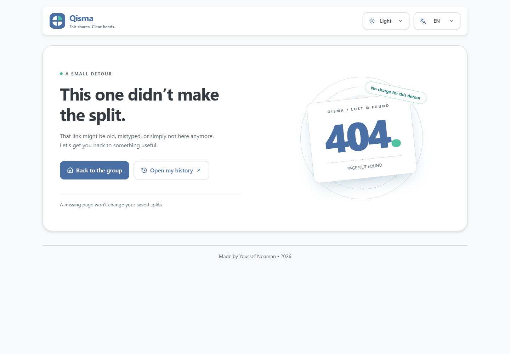

# Qisma | Fair shares. Clear heads.

[](https://github.com/YoussefNoaman96/Qisma/actions/workflows/quality.yml)
[Source code](https://github.com/YoussefNoaman96/Qisma) · [Architecture](docs/architecture.md)

A full-stack expense-sharing application with optional accounts, private cloud history, and a complete guest experience. Built with JavaScript, React, Tailwind CSS, Node.js, Express, and MongoDB Atlas.

## Preview

<div align="center">
  
  
  <br />
  
  
</div>

## Features

- Three steps: add at least two members, record expenses, and review settlements.
- Exact integer-piastre accounting, deterministic remainder allocation, and debt cancellation.
- Arabic-Indic and Persian numeral input with exact decimal validation.
- Downloadable PDF reports with embedded Arabic/Latin fonts, selectable text, exact balances, and automatic pagination.
- Copy a settlement summary for sharing in a group chat.
- A branded 404 page, recoverable rendering failures, and lightweight entrance motion with reduced-motion support.
- Add, edit, and delete expenses; preserve dated, immutable split snapshots.
- Optional registration and sign-in with private, cross-device history.
- Guest mode with browser-local history and automatic draft recovery.
- Explicit consent before copying guest history and a draft into an account.
- Delete individual records or clear your archive through a confirmation dialog.
- Versioned JSON backup export and atomic, deduplicated cloud imports.
- Responsive sliding authentication panels styled with Tailwind and existing theme tokens.
- English and Arabic, LTR/RTL layouts, light/dark themes, and keyboard-accessible controls.



## Stack

| Layer          | Technologies                                                        |
| -------------- | ------------------------------------------------------------------- |
| Interface      | React 19, Vite 6, Tailwind CSS 4, Lucide                            |
| Localization   | i18next, react-i18next                                              |
| API            | Node.js 22+, Express 5, JavaScript ES modules                       |
| Database       | MongoDB Atlas, Mongoose, compound indexes and transactions          |
| Authentication | Argon2id, JWT access cookies, rotating opaque refresh tokens        |
| Validation     | Shared Zod schemas and accounting invariants                        |
| Quality        | Node test runner, Supertest, Playwright, axe-core, ESLint, Prettier |

## Local Setup

Use Node.js **22.13 or later** and npm.

```bash
npm ci
```

Copy `server/.env.example` to `server/.env`. Set these values locally:

| Variable      | Purpose                                                                |
| ------------- | ---------------------------------------------------------------------- |
| `MONGODB_URI` | Atlas connection string, including the application database name       |
| `JWT_SECRET`  | A cryptographically random secret of at least 32 characters            |
| `APP_ORIGIN`  | Exact browser origin; default development URL: `http://127.0.0.1:5173` |
| `PORT`        | API port; default: `3001`                                              |
| `NODE_ENV`    | `development`, `test`, or `production`                                 |
| `TRUST_PROXY` | `0` directly, or `1` behind exactly one trusted reverse proxy          |

Generate a secret locally:

```bash
node -e "console.log(require('node:crypto').randomBytes(48).toString('base64url'))"
```

For Atlas, create a **database user** with access to the application database, allow your current development IP in Network Access, and select the application's database in the connection URI. Percent-encode special characters in the username/password. Use a dedicated application database and least-privilege credentials. Do not commit the environment file or paste its contents into logs, screenshots, or issues.

```bash
npm run dev:full
```

Open **http://127.0.0.1:5173**. Vite proxies `/api` to Node on port 3001 and fails clearly if its port is already occupied instead of silently moving to another port. Stop older development servers before starting another copy. In development, Origin checks accept both `127.0.0.1` and `localhost` on the configured port. Choose one hostname consistently because cookies and localStorage are separate for each hostname. Production accepts only the exact configured origin. Changes to `server/.env` require an API restart.

For a frontend-only guest session, `npm run dev` is sufficient. Authentication and cloud history require the API and database.

## Commands

| Command               | Description                                           |
| --------------------- | ----------------------------------------------------- |
| `npm run dev:full`    | Run the frontend and API together                     |
| `npm run dev`         | Run Vite only                                         |
| `npm run dev:server`  | Run the API with automatic source reload              |
| `npm run build`       | Build the frontend into `dist/`                       |
| `npm start`           | Start the API; also serve `dist/` in production       |
| `npm run preview`     | Preview the static build without the API              |
| `npm test`            | Run pure accounting, draft, and guest-history tests   |
| `npm run test:server` | Run isolated API/security/database integration tests  |
| `npm run test:e2e`    | Run guest and account workflows on desktop and mobile |
| `npm run screenshots` | Generate README workflow screenshots                  |
| `npm run lint`        | Check JavaScript, JSX, and hook usage                 |
| `npm run format`      | Format source and documentation                       |
| `npm run check`       | Lint, check formatting, run unit/API tests, and build |

On Windows, reuse the installed Microsoft Edge browser to avoid a browser download:

```powershell
$env:PLAYWRIGHT_CHANNEL = 'msedge'
npm run test:e2e
```

The project-local npm cache and test temporary files stay under the project directory on D. To use Playwright Chromium instead, install its browser before tests:

```bash
npx playwright install chromium
npm run test:e2e
```

API tests start a temporary MongoDB replica set through `mongodb-memory-server-core`. The first run downloads an official MongoDB binary into ignored `.tmp/mongodb/`. Tests **never load `server/.env`, connect to Atlas, or modify real accounts**. Browser tests use isolated ports 5174 and 3002 and fresh browser contexts. No production secrets are required in CI.

## Structure

```text
server/
  config/        Environment validation and MongoDB startup
  middleware/    CSRF/origin checks, request validation, rate limits, errors
  models/        Users, sessions, saved splits, shared rate counters
  routes/        Authentication and owner-scoped split endpoints
  services/      Password hashing, session rotation, archive operations
  testing/       Isolated test database and browser-test API
  tests/         API and database integration tests
  app.js         Express factory without network side effects
  index.js       Startup, database connection, graceful shutdown
shared/          Auth/split schemas and pure data invariants
src/
  auth/          Cookie-based API client, account context, local draft scope
  components/    Workflow, archive views, shared accessible controls
  hooks/         Draft state, guest/cloud archives, hash routes
  lib/           Accounting, storage, formatting, JSON backups
  locales/       English and Arabic interface text
  pages/auth/    Tailwind sign-in/sign-up layout and forms
e2e/             Desktop/mobile workflows and accessibility checks
tests/           Pure accounting and browser-storage tests
docs/            Screenshots and architecture notes
```

## Architecture

The Express factory separates application wiring from startup, so Supertest can exercise the real middleware and routes without starting the production server. Routes validate input and delegate session/archive operations to small services. Mongoose models define persistence and indexes. There is no generic repository or dependency-injection framework.

The React `AuthProvider` restores cookie sessions and owns sign-in/out. The API client attaches the CSRF header, refreshes an expired access token once, and coordinates concurrent refreshes. Authentication changes remount the workspace under a different account key to discard the previous account's interface state.

`useExpenseGroup` manages the current draft and forms. `useGuestHistory` and `useCloudHistory` expose equivalent archive actions. Cloud history uses cursor pagination; opening a saved split fetches it by ID, even when it is outside the loaded page. Loading, failures, and pending writes are visible in the interface.

Accounting remains independent of React and Express in `src/lib/expenses.js`. Balances and transfers are derived from source expenses rather than stored as mutable duplicate state. Frontend and API validation share pure group invariants; authentication uses the same Zod schemas on both sides.

Routes: `#/split`, `#/history`, `#/history/<id>`, `#/login`, and `#/register`. Unknown hash routes and unexpected URL paths show the branded 404 view; the production server returns HTTP 404 for missing HTML pages. Hash routing supports static guest demos without rewrite rules.

## Authentication and Security

- Passwords are hashed with **Argon2id** (19 MiB memory, two iterations, parallelism one). Passwords allow 15–128 Unicode characters, including spaces, and are never silently truncated.
- A signed **15-minute access JWT** lives in an `HttpOnly`, `SameSite=Strict` cookie. Production cookies also use `Secure`. Auth tokens are never stored in localStorage or returned in JSON.
- A random **7-day refresh token** is stored only as a SHA-256 hash in MongoDB and rotated using an atomic compare-and-swap. The session lifetime is fixed rather than extended indefinitely. Recognized reuse outside a short concurrent-request grace window revokes that session.
- Each authenticated request checks the server-side session, so logout takes effect immediately. Users can sign out of the current session or all sessions.
- Unsafe requests require an exact configured Origin. Authenticated mutations and refresh/logout additionally require a session-bound CSRF header. The readable CSRF cookie is a request-verification value, not an authentication token.
- Database-backed IP/email/account rate limits remain shared across API instances. Helmet supplies security headers. JSON body limits and strict schemas reject unknown fields and operator objects.
- Every archive query includes the authenticated owner ID. Supplying someone else's record ID cannot read or delete it. Owner identity is never accepted from request data.
- Errors return stable codes and request IDs. Unexpected exceptions and startup failures do not expose database URLs, credentials, passwords, or raw driver errors.

This version uses password authentication without email verification, password-reset delivery, or MFA. It does not display nonfunctional recovery/social-login links. Those features require additional flows and an email provider before they can be offered. See [deployment notes](docs/architecture.md) for operational limits and production setup.

## PDF Reports and Sharing

**Download PDF** on the results page exports the current split; on a saved split it exports that snapshot; on the archive list it exports the full available archive. Reports include save/preparation dates, totals, each member’s exact share and net balance, settlement transfers, and the expense ledger. They use the selected interface language, embed the Amiri font under its SIL Open Font License, preserve selectable text, and paginate long tables. PDF code and fonts load only when requested. Report generation stays on the device and sends no data to a third-party report service.

**Copy summary** prepares text for manual sharing, including the total and settlement transfers. It does not send messages or disclose account credentials or private record URLs. If clipboard access is unavailable, a selectable text field is provided.

PDF is a reading/sharing format. **Export JSON Backup** and **Import JSON Backup** remain available for restoring structured archive data; a PDF cannot be imported as a data backup.

## Storage, History, and Backups

| Data                        | Guest                        | Signed-in account                           |
| --------------------------- | ---------------------------- | ------------------------------------------- |
| Completed split history     | This browser's localStorage  | MongoDB, scoped to the account              |
| Unfinished draft and inputs | Guest localStorage namespace | Separate localStorage namespace per account |
| Theme and language          | Browser preferences          | Browser preferences                         |
| Session credentials         | None                         | Cookies; hashed refresh token on server     |

**Drafts stay local**, including for signed-in users. Only completed saved splits synchronize across devices. Local data can disappear if browser storage is cleared. Signing in does not silently upload guest data: the unchecked opt-in box copies it and keeps the guest originals. If copying fails, login still succeeds and the user can retry through a JSON backup import.

Entering results saves a nonempty snapshot; unchanged data reuses the original record and timestamp. Editing current expenses cannot mutate earlier snapshots. Deleting history keeps the current draft; a deleted record is not recreated by merely refreshing the page.

Backups use `{ version: 1, splits: [...] }`, with a **2 MB** limit. Cloud import/export is additionally limited to **500 records** per file. A split supports up to **200 members** and **2,000 expenses**. Imports deduplicate by canonical source data, reject ID/content conflicts, and use a MongoDB transaction to prevent partial writes. Guest backups use the same versioned shape. No authentication data is included.

Amounts use whole piastres: EGP 10.25 is `1025`. Uneven shares distribute remaining piastres in member order: EGP 100.00 shared by three becomes 33.34, 33.33, and 33.33. Settlement transfers cancel net debts without circular payments; the algorithm does not guarantee the global minimum transfer count.

## API

All endpoints are under `/api`; requests and responses use JSON. Errors use `{ error: { code, fields? }, requestId }`.

| Method | Endpoint                      | Behavior                                                    |
| ------ | ----------------------------- | ----------------------------------------------------------- |
| GET    | `/health`                     | Database readiness, without infrastructure details          |
| POST   | `/auth/register`              | Validate and create an account/session                      |
| POST   | `/auth/login`                 | Check credentials and create a session                      |
| GET    | `/auth/session`               | Restore the current user                                    |
| POST   | `/auth/refresh`               | Rotate the refresh token and issue access cookie            |
| POST   | `/auth/logout`                | Revoke the current session and clear cookies                |
| POST   | `/auth/logout-all`            | Revoke all sessions for the current user                    |
| GET    | `/splits?limit=20&cursor=...` | List owned snapshots with a next-page cursor                |
| POST   | `/splits`                     | Save validated members/expenses; deduplicate unchanged data |
| GET    | `/splits/:id`                 | Read one owned snapshot                                     |
| DELETE | `/splits/:id`                 | Delete one owned snapshot                                   |
| DELETE | `/splits`                     | Clear the current user's archive                            |
| GET    | `/splits/export`              | Downloadable versioned backup data                          |
| POST   | `/splits/import`              | Atomic validation/merge of a versioned backup               |

## Verification

Unit tests cover currency parsing, Arabic/Persian numerals, conservation of money, uneven shares, debt cancellation, malformed drafts, guest persistence, backups, failed writes, route parsing, and text extraction/pagination of generated English and Arabic PDFs. API tests cover hashing, cookie flags, validation, CSRF/Origin rejection, rate limits, refresh rotation/reuse, logout revocation, ownership, pagination, and atomic imports.

Browser tests exercise the original guest workflow plus optional registration, explicit guest copying, clean account workspaces, session restoration, cross-browser history access, cloud deletion, and sign-out everywhere. axe-core audits workflow/auth pages in both directions and themes; failure traces and screenshots are retained. Automated accessibility checks complement manual review.

GitHub Actions runs code checks, unit/API integration tests, and browser tests on pushes and pull requests. Workflow execution begins after the project is uploaded to GitHub.

## Branding and Repository

The public product is **Qisma**. Its name refers to fair division in Arabic. The interface remains functional React with pure accounting utilities; the old folder name described its university origin rather than the current architecture. The pie mark represents four clear shares and is supplied as SVG, browser favicon, and an Apple touch icon. The social preview is generated from `public/brand/social-preview.svg`; run `node scripts/brand-assets.mjs` after changing it.

Set the build-time `PUBLIC_SITE_URL` to the actual HTTPS deployment URL to emit absolute Open Graph image and canonical URLs. Without a deployment URL, preview metadata uses the configured Vite base path. The Pages workflow supplies the repository URL and `/Qisma/` base automatically. No production API credentials belong in frontend environment variables.

The local Git history starts with an honest snapshot of the pre-existing application and records the subsequent changes in focused Conventional Commits. It does not invent earlier development dates or represent deterministic invariant tests as a formal property-testing framework.

## Deployment

The complete application needs a **Node.js host plus MongoDB Atlas**. Build the frontend, set production environment variables, and start Express:

```bash
npm ci
npm run build
# Configure NODE_ENV=production, APP_ORIGIN=https://your-domain.example,
# MONGODB_URI, JWT_SECRET, PORT, and the correct TRUST_PROXY setting.
npm start
```

Terminate HTTPS at a trusted reverse proxy and route the entire application through one public origin. Express serves both `dist/` and `/api`; a separate cross-origin API deployment is not configured. Restrict Atlas network access to the server, use protected environment variables, and configure backups and monitoring before relying on cloud history.

The manual **Deploy guest demo to GitHub Pages** workflow publishes only the static guest experience. GitHub Pages cannot run this Node.js API. Account login and cloud history require the full Node deployment; describe a Pages link as a guest demo.

Hashed `dist/assets/index-[hash].js` and `.css` files are generated bundles for caching. Edit source and rebuild. Environment files, dependencies, generated builds, test data, and local caches are excluded from version control.

## Author

Youssef Noaman
