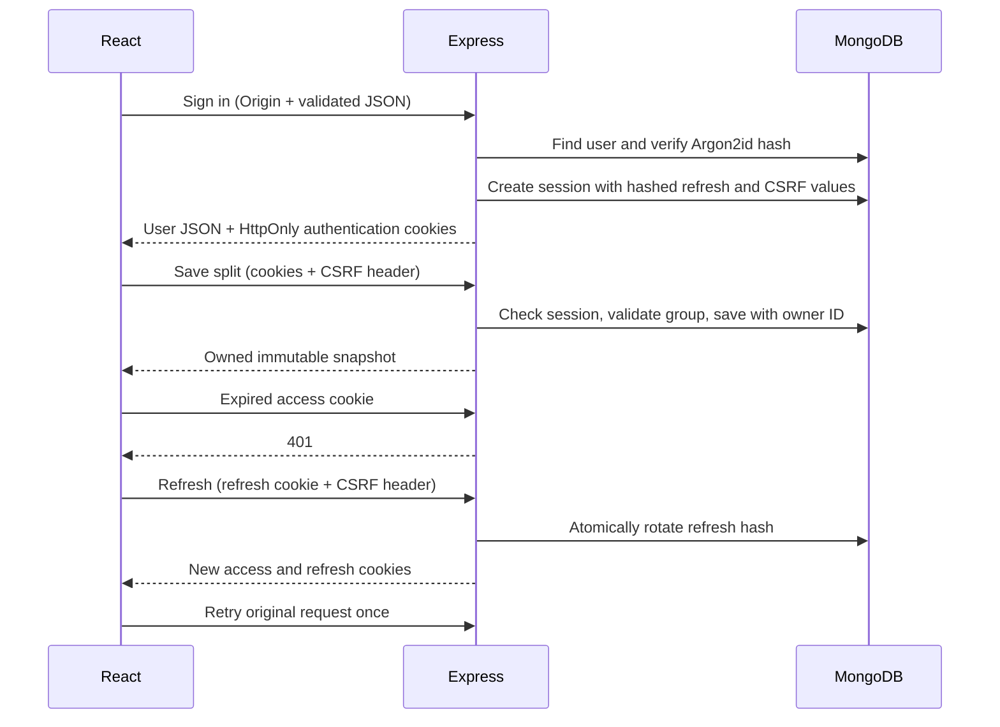

# Architecture and Deployment Notes

## Client reports and recovery

Qisma builds PDF reports on the device with jsPDF and AutoTable. The report module and licensed Amiri fonts load on demand. The PDF contains selectable text and paginated tables rather than screenshots; Arabic shaping and bidirectional ordering preserve mixed Arabic/Latin names and exact numeric amounts. JSON archives retain their versioned import/export contract for restoring data.

Unknown routes render the recovery page, while production HTML requests for missing paths return HTTP 404. A React error boundary provides a reload action without clearing browser data. Entrance animation uses opacity and translation only, with no scroll listener or animation framework; the reduced-motion media query disables it.

Theme foregrounds and backgrounds switch together before paint. Colour transitions are briefly suspended during the theme change so intermediate blends cannot reduce text contrast; normal control transitions resume afterward. Browser tests verify the first painted colour pair as well as the settled page.

## Request flow

## Model responsibilities

- `User`: normalized email, display name, and Argon2id password hash. A unique email index enforces account identity under concurrent registrations.
- `Session`: user ID, hashed refresh and CSRF values, fixed expiry, revocation, and previously rotated hashes. TTL cleanup is housekeeping; authorization independently checks expiry and revocation.
- `Split`: owner ID, public record ID, saved timestamp, canonical fingerprint, and copied member/expense data. Compound indexes enforce per-owner ID/content uniqueness and support cursor ordering.
- `RateLimit`: hashed fixed-window bucket keys, count, and expiry. Shared Mongo counters keep limits consistent across Node instances. Fixed windows allow a boundary burst; infrastructure-level request limits can complement these controls.

## Deployment boundaries

The application is designed for a single public HTTPS origin. Vite proxies API requests in development; Express serves the React build in production. SameSite cookies and Origin verification depend on this arrangement. `APP_ORIGIN` must match the public browser origin exactly.

Set `TRUST_PROXY=1` only when the application is behind exactly one trusted proxy that controls forwarded headers and the Node port is not directly reachable by clients. Otherwise keep it at zero. Incorrect proxy trust can weaken IP rate limits or combine unrelated users into one bucket.

MongoDB Atlas supplies a replica set, which supports the transactions used for backup imports. Use a dedicated database and credentials scoped to it. Startup initializes indexes; for a large existing database, plan index changes as explicit deployments. Set Atlas network access for application servers and avoid a broad public allowlist.

## Capacity and reliability

The API can run in multiple instances with the same database and JWT secret: sessions and rate counters are shared rather than held in process memory. Each instance uses a bounded connection pool of 20. History reads use owner indexes and cursor pagination instead of unbounded archive reads. Session lookups on every protected request provide immediate revocation at the cost of database reads.

This design provides a practical baseline; it does not establish a supported concurrent-user count. Capacity depends on Atlas tier, Node resources, traffic shape, password-hashing load, snapshot size, and network latency. Load-test expected traffic, monitor response times and database resources, and choose hosting capacity from those measurements.

Use HTTPS, host-level request limits, uptime/error monitoring, Atlas backups, and a tested recovery process for a public service. Rotating `JWT_SECRET` invalidates current access cookies; a compromised deployment should also revoke persisted sessions. Graceful shutdown stops new requests and closes database connections.

## Deliberate scope

- Accounts are optional. Guest data remains on the device unless the user explicitly imports it.
- Signed-in history synchronizes; drafts are local and separated by account ID. Signing out does not erase local drafts. Browser-local drafts are not a secure vault on shared devices.
- Email verification, password reset email delivery, MFA, account deletion, and live collaboration are not implemented. UI does not promise these features.
- Historical records are immutable snapshots. Edits produce a new saved snapshot; there is no concurrent shared-group editing flow.
- Cloud export/import supports at most 500 records and 2 MB per file; it is not a full database backup system.
- The five-second refresh concurrency grace returns a retry response for a recognized recently rotated token; it does not reissue credentials from the old token. Reuse after that window revokes the session.
- A session ends after 1,024 refresh rotations even if its seven-day expiry has not arrived. This bounds replay-history storage without forgetting previously used tokens while the session remains active.

## Safe test environments

Unit tests use in-memory browser-storage doubles. API and account browser tests create temporary local MongoDB replica sets, with unique ephemeral database credentials unnecessary for loopback-only test processes. Tests do not read the real Atlas URI. Test processes stop their temporary MongoDB instances and remove their transient data; only the ignored downloaded binary cache is retained for faster subsequent runs.
